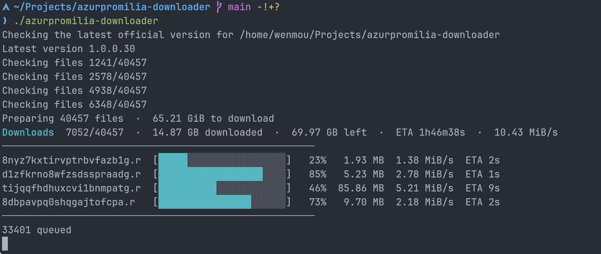

# Azur Promilia Downloader

[简体中文](README.md)

A third-party downloader for Linux that checks the official Azur Promilia release and downloads game resources directly from the game's CDN.

## Usage

Run the same command for the first download and later updates. The downloader uses the current directory if you omit `--dir`.

```sh
./azurpromilia-downloader --dir /path/to/your/AzurPromilia
```



The downloader checks local files against the latest official index, skips files that pass verification, and downloads missing or changed files. It uses four download workers by default. Run the same command again after an interruption to resume. The game directory holds temporary files and the installation record under `.azur-download/`.

Use `--workers` to set the number of concurrent file downloads and `--limit` to cap the combined download speed. `--limit 20` means 20 MB/s. Use `--limit 0` for unlimited speed.

```sh
./azurpromilia-downloader --dir /path/to/your/AzurPromilia --workers 8 --limit 20
```

`./azurpromilia-downloader check` shows the official version, download size, and estimated install size. Add `--dir /path/to/your/AzurPromilia` to find installations in that directory and its subdirectories and compare their versions.

`./azurpromilia-downloader plan --dir /path/to/your/AzurPromilia` previews the download size and disk space needed for the target directory.

Run `./azurpromilia-downloader --help` for available options.

## Build from source

Go 1.25 or later is required to build.

```sh
git clone https://github.com/mengdehong/azurpromilia-downloader.git --depth=1
cd azurpromilia-downloader
go build .
```

## Steam

To skip the official launcher in Steam, add `-start=azurpromilia_launcher` to the game's launch options.
