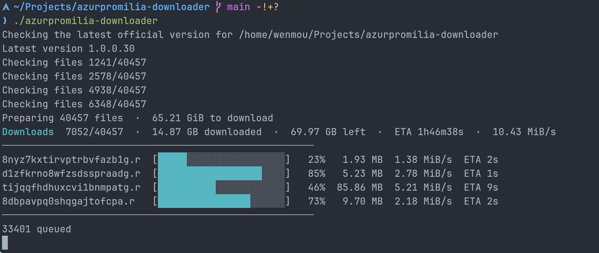

# アズールプロミリア ダウンローダー

[简体中文](README.md) · [English](README.en.md)

Linux 向けの非公式ダウンローダーです。ゲームファイルを公式 CDN から取得します。

## 使い方

ビルドには Go 1.25 以降が必要です。初回ダウンロードと更新には同じコマンドを使います。以下は日本版の例です。

```bash
git clone https://github.com/mengdehong/azurpromilia-downloader.git --depth=1
cd azurpromilia-downloader
go build .
./azurpromilia-downloader --region jp --dir /path/to/AzurPromiliaJP
```

`--region` を省略すると中国版が選択されます。保存先はリージョンごとに分けてください。`--dir` を省略した場合は、カレントディレクトリに保存されます。



ファイルを配信リストと照合し、不足分と更新分をダウンロードします。中断した場合は、同じコマンドで再開できます。一時ファイルとインストール記録は、保存先の `.azur-download/` に格納されます。

`--workers` で同時ダウンロード数（既定値は 10）、`--limit` で全体の転送速度の上限を指定できます。`--limit 20` は 20 MB/s です。

`check` で配信バージョンを確認できます。`--dir` を追加すると、そのディレクトリ以下から本ツールでインストールしたゲームを探し、バージョンを比較します。

`plan` でダウンロード量と必要な空き容量を確認できます。`verify` でファイルの整合性を確認できます。各コマンドでも同じリージョンを指定してください。

利用できるオプションは `./azurpromilia-downloader --help` で確認できます。
