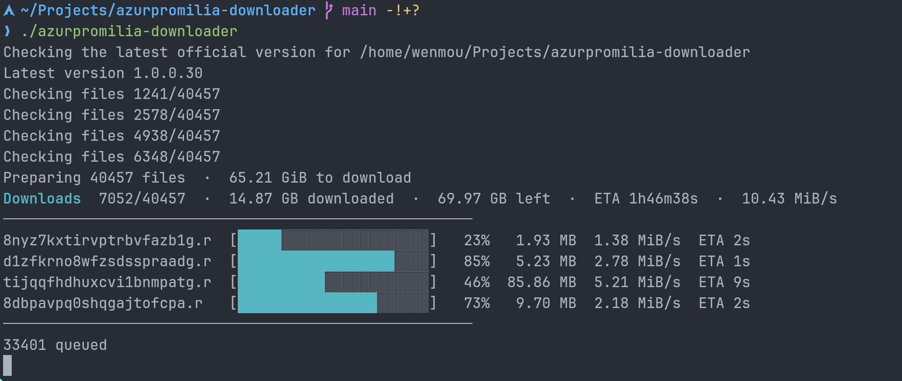

# 蓝色星原：旅谣 下载器

[English](README.en.md) · [日本語](README.ja.md)

面向 Linux 的第三方下载器，通过官方 CDN 下载《蓝色星原：旅谣》的游戏资源。

## 使用

构建需要 Go 1.25 或更新版本。首次下载和后续更新使用同一条命令。省略 `--dir` 时，资源下载到当前目录。

```bash
git clone https://github.com/mengdehong/azurpromilia-downloader.git --depth=1
cd azurpromilia-downloader
go build .
./azurpromilia-downloader --dir /path/to/your/AzurPromilia
```



默认下载国服（`--region cn`）。用 `--region jp` 选择日服，并为两个区服使用各自的目录。

下载器会根据资源索引检查本地文件，跳过已有文件，并下载缺失或发生变更的文件。

默认使用 10 个并发下载任务。如果下载过程中断，再次运行相同的命令即可继续下载。临时文件和安装记录均保存在指定目录的 `.azur-download/` 中。

用 `--workers` 调整文件下载并发数，用 `--limit` 设置总下载速度上限。`--limit 20` 表示 20 MB/s。

```bash
./azurpromilia-downloader --dir /path/to/your/AzurPromilia --workers 8 --limit 20
```

`./azurpromilia-downloader check` 查看官方版本和下载大小。加上 `--dir /path/to/your/AzurPromilia` 可递归查找该目录下的游戏安装并比较版本。

`./azurpromilia-downloader plan --dir /path/to/your/AzurPromilia` 查看该目录的预计下载量和所需磁盘空间。

运行 `./azurpromilia-downloader --help` 可查看可用选项。


## 注

在 Steam 等启动器，配置`-start=azurpromilia_launcher`跳过官方启动器
